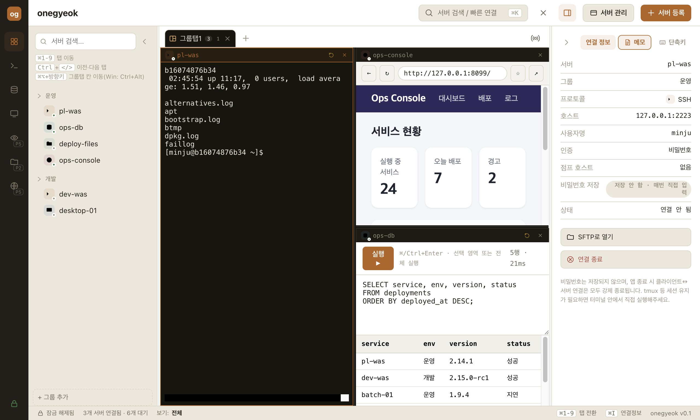
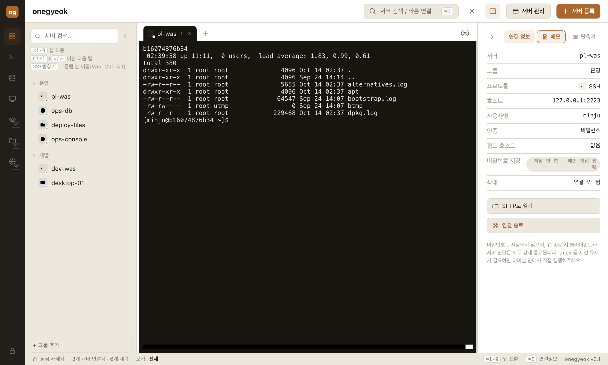
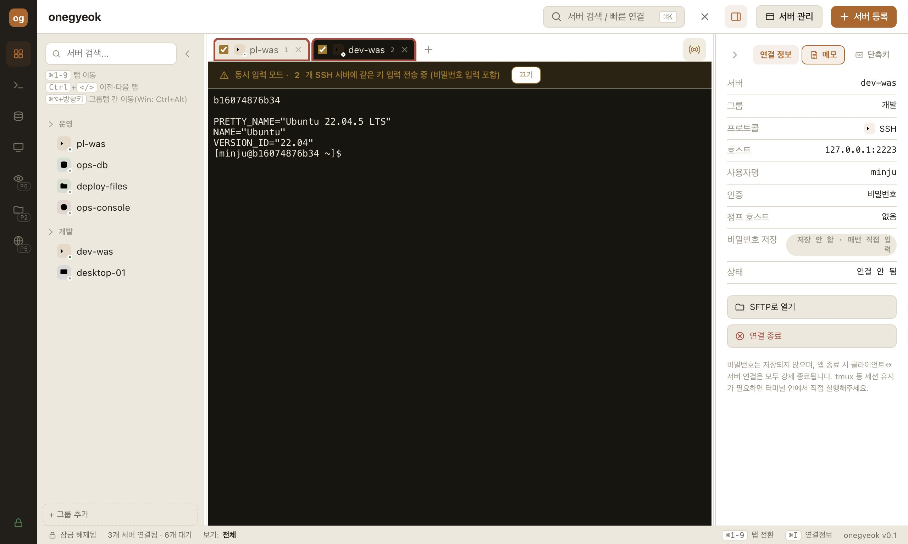
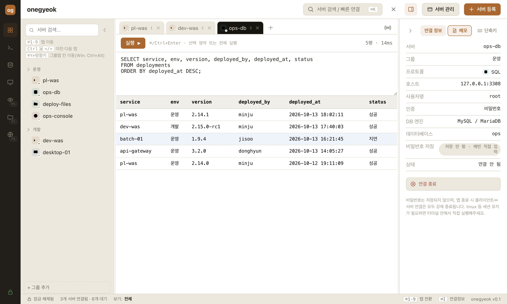
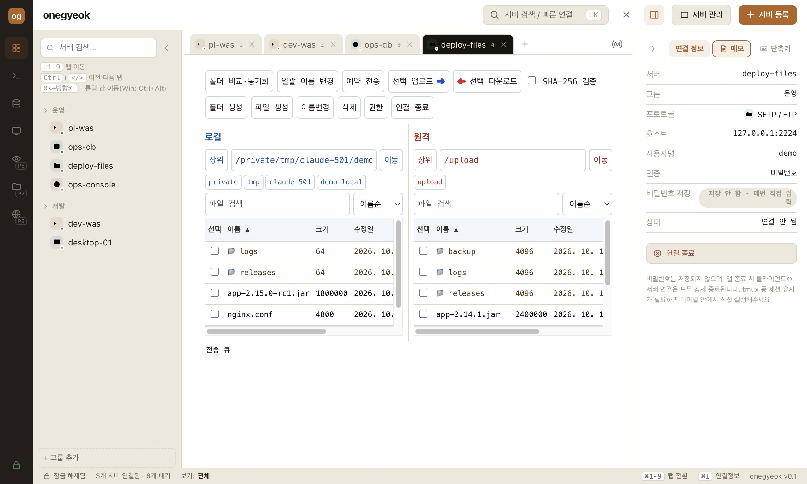
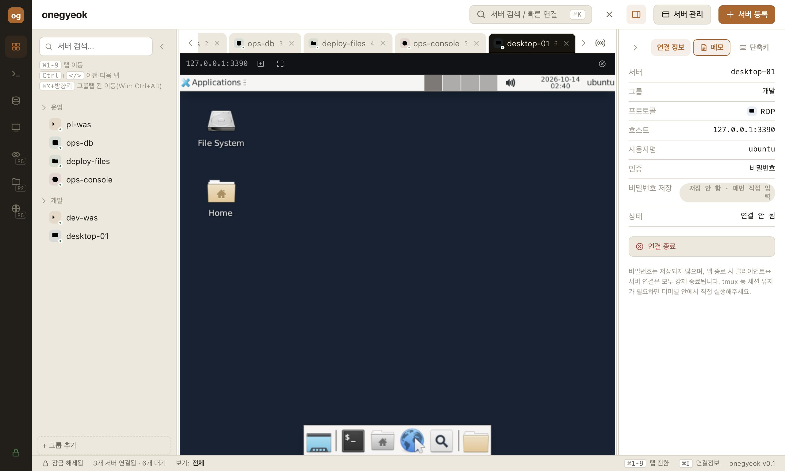
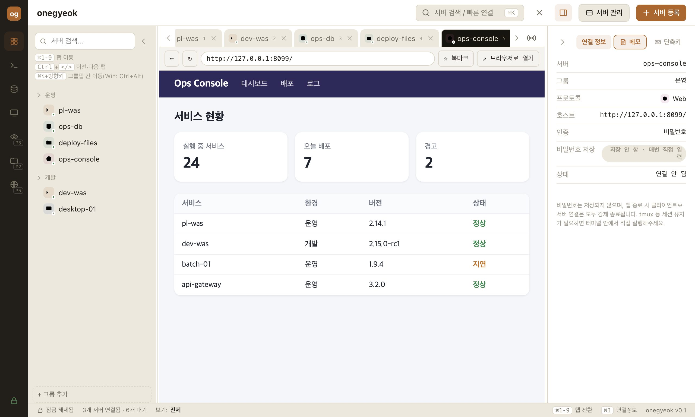
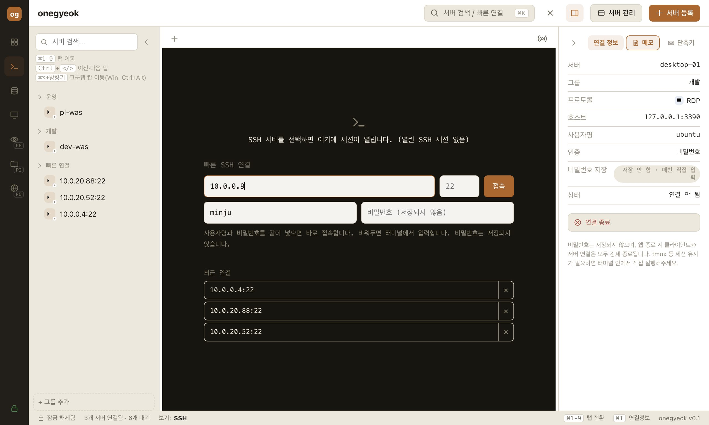
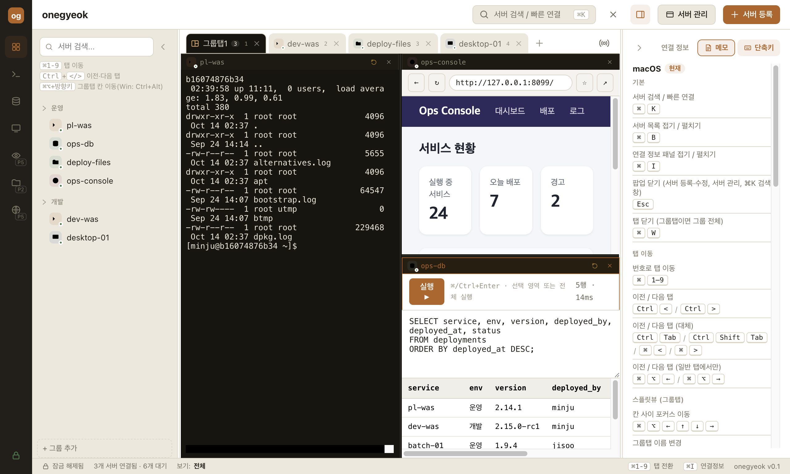

<h1 align="center">
   onegyeok
</h1>

  
  
  
  

  <a href="docs/readme/README.zh-CN.md">中文</a> · <a href="docs/readme/README.ja.md">日本語</a> · <a href="docs/readme/README.en.md">English</a>

  <strong>SSH · SQL · SFTP · RDP · VNC · Web — 흩어진 원격 접속 클라이언트를 하나로.</strong> 
  서버 등록 한 번으로 프로토콜에 맞게 바로 연결하고, 여러 세션을 한 화면에 나란히 띄웁니다. 
  비밀번호는 어디에도 저장하지 않고, 접속할 때마다 직접 입력합니다.

  
  &nbsp;
  

  설치 방법과 <b>처음 실행 시 보안 허용 안내</b>는 아래 <a href="#install">Install</a>을 확인하세요 · <a href="https://github.com/minaridat/onegyeok/releases">전체 릴리스</a>

  

---

## Features

<table>
<tr>
<td width="42%" valign="middle">

### 스플릿뷰 (그룹탭)

탭을 끌어 다른 탭 화면의 가장자리에 놓으면 **SSH · SQL · SFTP · RDP · VNC · Web 어느 조합이든** 한 화면에 나란히 보입니다. 최대 6칸, 경계선을 끌어 크기를 조절하고, 칸 헤더를 탭바로 끌면 다시 독립 탭이 됩니다.

[사용법 →](#split-view)

</td>
<td width="58%">
  
</td>
</tr>
<tr>
<td width="42%" valign="middle">

### SSH 터미널

xterm.js 기반 터미널. 로그인 아이디는 보이고 비밀번호는 `*`로 표시되며, 접속 프롬프트가 **터미널 안에서** 바로 뜹니다. Key 인증과 점프 호스트도 지원합니다.

[사용법 →](#connect)

</td>
<td width="58%">
  
</td>
</tr>
<tr>
<td width="42%" valign="middle">

### 여러 서버 동시 입력

여러 SSH 세션을 체크해 묶으면 **비밀번호 입력 단계부터** 같은 키 입력이 전부에 동시에 전송됩니다. 대상은 빨간 테두리로 표시됩니다.

[사용법 →](#broadcast)

</td>
<td width="58%">
  
</td>
</tr>
<tr>
<td width="42%" valign="middle">

### SQL 클라이언트

MySQL / MariaDB · PostgreSQL · MS SQL Server에 접속해 쿼리를 실행하고 결과를 표로 확인합니다.

[사용법 →](#connect)

</td>
<td width="58%">
  
</td>
</tr>
<tr>
<td width="42%" valign="middle">

### SFTP / FTP / FTPS 파일 탐색기

로컬·원격 **듀얼 패널**, 파일·폴더 재귀 전송, 폴더 비교·동기화, 일괄 이름 변경, 예약 전송, 전송 큐(일시정지·재개·취소), SHA-256 검증.

[사용법 →](#connect)

</td>
<td width="58%">
  
</td>
</tr>
<tr>
<td width="42%" valign="middle">

### RDP · VNC 원격 데스크톱

외부 서버 없이 네이티브 헬퍼가 원격 화면을 그대로 렌더링합니다. 창 크기를 바꾸면 **원격 해상도가 따라 바뀌고**(RDP), 전체화면·실제 크기 보기를 지원합니다.

[사용법 →](#connect)

</td>
<td width="58%">
  
</td>
</tr>
<tr>
<td width="42%" valign="middle">

### Web 콘솔 · 북마크

내장 브라우저로 사내 웹 콘솔을 엽니다. 주소창을 크롬처럼 직접 고쳐 이동하고, `☆ 북마크`로 현재 페이지를 서버로 등록합니다. 쿠키는 디스크에 남지 않습니다.

[사용법 →](#connect)

</td>
<td width="58%">
  
</td>
</tr>
<tr>
<td width="42%" valign="middle">

### 빠른 연결

서버를 등록하지 않아도 **호스트·사용자명·비밀번호를 한 폼에** 넣으면 바로 접속합니다. 프로토콜별 최근 5개 이력을 `×`로 지우고, 주소를 잘못 쳤으면 탭 위에서 고쳐 다시 연결합니다.

[사용법 →](#quick-connect)

</td>
<td width="58%">
  
</td>
</tr>
<tr>
<td width="42%" valign="middle">

### 단축키 가이드 내장

오른쪽 패널의 **단축키** 탭에 macOS / Windows 단축키가 모두 정리되어 있습니다(현재 OS가 위에 표시).

[단축키 표 →](#shortcuts)

</td>
<td width="58%">
  
</td>
</tr>
</table>

**그 밖에:**

- **비밀번호 저장 없음** — 비밀번호·Key Passphrase는 연결 1회에만 메모리에서 쓰이고 폐기됩니다(ISMS 심사 대응).
- **서버 목록 암호화 저장** — 호스트·그룹·메모는 OS 키체인 기반으로 암호화되어 재실행 후에도 유지됩니다.
- **같은 서버로 여러 세션** — 서버를 다시 클릭하면 항상 새 탭·새 연결이 열립니다.
- **여러 창** — 탭을 창 밖으로 끌어내면 새 창으로 분리됩니다. 창 제목은 `onegyeok 6`처럼 열린 세션 수가 표시됩니다.
- **앱 종료 시 모든 연결 강제 종료** — 보이지 않는 자동 유지는 하지 않습니다.

---

## Install

### macOS — Apple Silicon (M1 이상), macOS 15 이상

1. **[onegyeok-arm64.dmg 다운로드](https://github.com/minaridat/onegyeok/releases/latest/download/onegyeok-arm64.dmg)** 후 열어서 `onegyeok`을 **응용 프로그램** 폴더로 드래그합니다.
2. **처음 실행할 때 보안 허용이 필요합니다.** 아직 Apple 공증을 받지 않은 앱이라 macOS가 *"확인되지 않은 개발자"* 경고로 막습니다. 한 번만 허용하면 이후엔 바로 열립니다.

   > **시스템 설정 → 개인정보 보호 및 보안** → 아래쪽 **"그래도 열기"** 클릭 → 암호/Touch ID 인증

   (먼저 `응용 프로그램`에서 `onegyeok`을 더블클릭해 경고를 한 번 띄워야 "그래도 열기"가 나타납니다.)

   터미널을 쓰는 방법: `xattr -dr com.apple.quarantine /Applications/onegyeok.app`
3. 인텔(x64) Mac은 지원하지 않습니다. 필요한 런타임(RDP/VNC 헬퍼 포함)은 모두 설치 파일 안에 들어 있습니다.

### Windows — Windows 10 22H2 이상 / 11 (x64)

1. **[onegyeok-x64.exe 다운로드](https://github.com/minaridat/onegyeok/releases/latest/download/onegyeok-x64.exe)** 후 실행합니다(설치 위치 선택 가능, 관리자 권한 불필요).
2. **"Windows의 PC 보호"(SmartScreen)** 창이 뜨면 **추가 정보 → 실행**을 누르세요. 아직 코드 서명 인증서가 없는 설치 파일이라 나오는 경고입니다.

> 앱 데이터(서버 목록·메모)는 macOS `~/Library/Application Support/onegyeok/`, Windows `%APPDATA%\onegyeok\`에 암호화되어 저장되며 앱을 삭제해도 남습니다. 완전히 지우려면 이 폴더도 삭제하세요.

소스에서 실행하거나 설치 파일을 직접 빌드하려면 **[개발자 가이드](docs/DEVELOPER.md)** 를 보세요.

---

## 사용 매뉴얼

### 시작하기

1. 상단 **[+ 서버 등록]**으로 서버를 등록합니다(이름·그룹·프로토콜·호스트·포트·사용자명). 또는 등록 없이 레일에서 프로토콜을 골라 **[빠른 연결](#quick-connect)** 합니다.
2. 왼쪽 서버 목록에서 서버를 클릭하면 **새 탭**이 열리고 접속을 시작합니다.
3. 비밀번호는 접속 때마다 직접 입력합니다(저장하지 않음).

### 화면 구성

| 영역 | 설명 |
|---|---|
| **왼쪽 레일** | 프로토콜 필터(전체·SSH·SQL·RDP·VNC·SFTP·Web). 열린 세션이 없으면 빠른 연결 폼이 나타납니다 |
| **상단바** | `서버 검색 / 빠른 연결`(⌘K) · 탭 닫기 · 연결 정보 패널 토글 · `서버 관리` · `서버 등록` |
| **서버 목록** | 그룹별 서버 트리. `‹` 버튼(⌘B)으로 접으면 줄까지 사라지고 탭줄 왼쪽의 작은 버튼으로 다시 엽니다 |
| **탭줄** | 열린 세션 탭. 오른쪽 `((•))`가 동시 입력 토글이고, 그 옆 작은 버튼으로 접힌 연결 정보 패널을 다시 엽니다 |
| **연결 정보 패널** | `연결 정보 · 메모 · 단축키` 3개 탭. `›`(⌘I)로 접기 |

### 접속하기

| 프로토콜 | 접속 방법 | 주요 기능 |
|---|---|---|
| **SSH** | 터미널에 `login as:` / `password:`가 뜨면 입력(비밀번호는 `*`). 실패 시 최대 3회 재입력, `Ctrl+C` 취소. 끊기면 탭의 ↻로 재연결 | Key 인증, 점프 호스트, **SFTP로 열기**, 동시 입력 |
| **SQL** | 접속 폼에 (사용자명·)비밀번호 입력 | MySQL/MariaDB·PostgreSQL·MS SQL, `⌘/Ctrl+Enter` 실행(선택 영역만 실행 가능), 결과 표 |
| **SFTP / FTP / FTPS** | 사용자명·비밀번호 입력 | 듀얼 패널, 드래그/버튼 업·다운로드(**선택 업로드 ➜** 파랑 · **➜ 선택 다운로드** 빨강), 비교·동기화, 일괄 이름 변경, 예약 전송, 전송 큐, SHA-256 검증. 평문 FTP는 접속 전 경고 |
| **RDP / VNC** | 접속 폼에 (사용자명·)비밀번호 입력 | 툴바: 실제 크기 ↔ 창에 맞춤 · 전체화면 · 연결 종료. RDP는 창/칸 크기에 맞춰 해상도 자동 변경 |
| **Web** | URL을 서버로 등록(또는 빠른 연결) | 주소창 직접 수정(Enter 이동·Esc 되돌리기), 뒤로·새로고침, `↗` 기본 브라우저로 열기, `☆ 북마크`. 자체 서명 인증서는 기본 차단 후 "이 탭에서만 계속"으로 허용 |

### 빠른 연결

서버를 등록하지 않고 바로 접속합니다. 레일에서 프로토콜을 고르면(열린 세션이 없을 때) 폼이 뜹니다.

- **한 폼에서 끝** — 호스트·포트·사용자명·비밀번호를 같이 넣고 **접속**하면 접속 화면 없이 바로 연결됩니다(VNC는 비밀번호만, Web은 주소만).
- **최근 5개** — 프로토콜별 이력(호스트·포트·사용자명만, **비밀번호는 저장 안 함**)이 남고 `×`로 개별 삭제합니다.
- **주소를 잘못 쳤다면** — 탭 위의 주소 바에서 주소·사용자명·비밀번호를 고쳐 **다시 연결**을 누르면 잘못 친 이력은 함께 정리됩니다.

### 스플릿뷰

1. **합치기** — 탭을 끌어 다른 탭 화면의 **가장자리(25%)** 에 놓으면 그 방향으로 분할됩니다(가운데는 무동작, 한도 초과 방향은 회색).
2. **그룹탭** — 합쳐진 탭은 `그룹탭1`처럼 탭 하나로 보입니다. **더블클릭**하면 이름을 바꿉니다(Enter 확정 · Esc 취소).
3. **칸 헤더** — 서버 이름·상태와 **동시 입력 체크(SSH) · 재연결 ↻ · 닫기 ×**. 칸을 클릭하면 그 칸이 포커스를 받고 연결 정보 패널도 그 서버로 바뀝니다.
4. **크기 조절** — 칸 사이 경계선을 끕니다(최소 280×180px, 최대 6칸).
5. **빼내기** — 칸 헤더를 탭바로 끌면 독립 탭으로 돌아옵니다. 창 밖으로 끌면 새 창으로 분리됩니다.
6. 분할 구성은 **저장되지 않습니다**(앱을 다시 켜면 개별 탭).

### 동시 입력

탭줄 오른쪽 `((•))`를 켜면 열린 SSH 세션에 체크박스가 생기고(스플릿뷰에서는 칸 헤더) 상단에 경고 배너가 뜹니다. 체크된 세션은 **빨간 테두리**로 표시되며, 입력은 비밀번호 프롬프트부터 체크된 모든 서버에 동시에 전송됩니다. 비밀번호가 여러 서버로 가므로 신중히 사용하세요.

### 단축키

| 동작 | macOS | Windows |
|---|---|---|
| 서버 검색 / 빠른 연결 | `⌘K` | `Ctrl+K` *(터미널에 입력 중일 때는 동작 안 함)* |
| 서버 목록 접기/펼치기 | `⌘B` | `Ctrl+B` *(터미널 입력 중에는 동작 안 함)* |
| 연결 정보 패널 접기/펼치기 | `⌘I` | `Ctrl+I` *(터미널에 입력 중일 때는 동작 안 함)* |
| 팝업 닫기 (서버 등록·수정, 서버 관리, `⌘K` 검색창) | `Esc` | `Esc` |
| 탭 닫기 (그룹탭이면 그룹 전체) | `⌘W` | `Ctrl+Shift+W` |
| 번호로 탭 이동 | `⌘1`–`⌘9` | `Ctrl+1`–`Ctrl+9` *(터미널에 입력 중일 때는 동작 안 함)* |
| 이전 / 다음 탭 | `Ctrl+<` / `Ctrl+>` | `Ctrl+<` / `Ctrl+>` |
| 이전 / 다음 탭 (대체) | `Ctrl+Tab` / `Ctrl+Shift+Tab`, `⌘<` / `⌘>` | `Ctrl+Tab` / `Ctrl+Shift+Tab` |
| 그룹탭 칸 사이 이동 | `⌘⌥+방향키` | `Ctrl+Alt+방향키` |
| SQL 쿼리 실행 | `⌘Enter` | `Ctrl+Enter` |
| 그룹탭 이름 변경 | 탭 더블클릭 → `Enter` / `Esc` | 동일 |

마우스: 탭을 화면 가장자리로 끌어 **합치기** · 칸 헤더를 탭바로 끌어 **빼내기** · 경계선을 끌어 **크기 조절** · 창 밖으로 끌어 **새 창 분리**.

### 자주 묻는 질문

<b>비밀번호는 정말 어디에도 저장되나요?</b>

저장하지 않습니다. 접속할 때마다 입력하고, 연결 1회에만 메모리에서 쓴 뒤 폐기합니다. 서버 목록·메모·빠른 연결 이력(호스트·포트·사용자명)만 OS 키체인 기반으로 암호화해 저장합니다.

<b>다른 Mac/PC에서도 서버 목록이 보이나요?</b>

아니요. 암호화 키가 그 컴퓨터의 로그인 키체인(Windows는 DPAPI)에만 있고 iCloud 키체인으로 동기화되지 않아, 컴퓨터마다 따로 등록해야 합니다. `servers.dat` 파일만 복사해도 열리지 않습니다.

<b>앱을 종료하면 SSH 세션이 유지되나요?</b>

아니요. 앱을 종료하면 열려 있던 모든 연결이 끊깁니다. 서버 쪽 세션 유지가 필요하면 터미널에서 `tmux` 등을 직접 실행하세요.

<b>서버 목록을 완전히 초기화하려면?</b>

`~/Library/Application Support/onegyeok`(Windows `%APPDATA%\onegyeok`) 폴더를 삭제하고, macOS는 키체인 접근에서 `onegyeok Safe Storage` 항목도 삭제하세요.

---

## 문서

| | |
|---|---|
| **[개발자 가이드](docs/DEVELOPER.md)** | 소스에서 실행 · 설치 파일 직접 빌드(macOS/Windows) · 기술 스택 |
| [기능 명세](docs/기능명세/) | 연결 종류별 기능 명세와 완료 기준 |
| [QA 내역](docs/QA.md) | 검증된 항목과 남은 과제 |
| [기획서](docs/기획서.md) | 기획 배경, 보안 요구사항 |

## 보안 요약

- 비밀번호·Key Passphrase는 어떤 형태로도 저장하지 않습니다.
- 서버 목록·메모는 OS 자격증명 저장소(macOS Keychain / Windows DPAPI) 기반 Electron `safeStorage`로 암호화합니다.
- Web 콘솔 쿠키는 탭별 메모리 전용 파티션이라 디스크에 남지 않고, 계정 자동입력은 없습니다.
- 앱 종료 시 SSH/SQL/RDP/VNC/SFTP 연결을 예외 없이 종료합니다.
