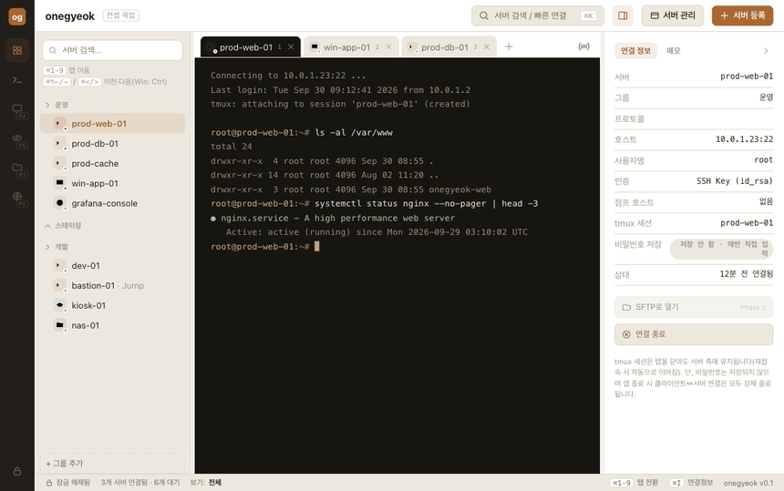

# onegyeok

**SSH · RDP · VNC · SFTP · Web — 흩어진 원격 접속 클라이언트를 하나로.**
서버/인프라 엔지니어를 위한 올인원 원격 접속 데스크톱 앱입니다. 사내 ISMS 인증 심사를 염두에 두고
설계되어, 비밀번호는 어디에도 저장하지 않고 접속할 때마다 터미널 안에서 직접 입력합니다.



> 위 데모는 로컬 SSH 서버에 실제로 접속하는 화면입니다 — 서버 등록 → 터미널 안에서 비밀번호 직접
> 입력 → 여러 서버 동시 입력(브로드캐스트) 모드까지 실제 동작 그대로입니다.


-444?style=flat-square)


---

## 왜 onegyeok인가

인프라 엔지니어는 하루에도 SSH(+tmux), RDP, VNC, SFTP 클라이언트를 번갈아 켭니다. 보통 이 조합은
Termius, Royal TSX, FileZilla Pro처럼 각각 유료 프로그램으로 따로 씁니다. onegyeok은 이걸 한 앱에서
**서버 등록 한 번으로 프로토콜에 맞게 바로 연결**되게 합니다.

- **비밀번호 자동 저장 없음** — ISMS 심사 시 심사위원 앞에서 비밀번호를 직접 입력해야 한다는 요구사항을
  반영해, 애초에 비밀번호/Key Passphrase를 어디에도 저장하지 않습니다. 접속할 때마다 터미널 안에
  `user@host's password:` 프롬프트가 뜨고 그 자리에서 직접 타이핑합니다 — 일반 `ssh` 커맨드라인과
  동일한 경험입니다.
- **여러 서버 동시 입력(브로드캐스트)** — tmux `synchronize-panes`, Termius Multi Exec와 같은 개념.
  여러 서버에 접속 프롬프트를 띄워놓고 비밀번호를 한 번만 입력하면 선택된 모든 서버에 동시에 들어갑니다.
  접속 이후의 일반 명령도 동일하게 동시 전송됩니다.
- **같은 서버로 여러 세션 동시 접속** — 서버를 다시 클릭하면 기존 탭에 포커스만 이동하지 않고 항상
  새 탭·새 연결을 엽니다. 다른 작업을 병행하거나 다른 계정으로 동시에 들어갈 때 유용합니다
  (tmux 등 세션 유지 도구는 자동 실행하지 않습니다 — 필요하면 터미널에서 직접 실행하세요).
- **SQL DB 클라이언트 ("SQL" 연결 종류)** — 디비버 느낌으로 MySQL/MariaDB, PostgreSQL, MS SQL Server에
  접속해 쿼리를 실행하고 결과를 테이블로 봅니다. 비밀번호는 SSH와 동일하게 저장하지 않습니다.
- **SFTP / FTP / FTPS 파일 탐색기** — 듀얼 패널, 파일·폴더 재귀 업/다운로드, 비교 후 한 방향 동기화, 로컬/원격 일괄 이름 변경, 활성 연결에서 1회 예약 전송, 전송 큐·일시정지/재개/취소, 원격 파일 관리와 선택형 SHA-256 검증을 제공합니다. SSH 등록 정보에서 별도 SFTP 탭을 열 수 있습니다. 자세한 지원 범위는 [파일 전송 명세](./docs/기능명세/03_SFTP_기능명세.md)를 참고하세요.
- **RDP/VNC 원격 데스크톱** — `libfreerdp`/`libvncclient`를 직접 링크한 네이티브 헬퍼(외부 서버·Docker
  불필요)가 실제 원격 화면을 `<canvas>`에 렌더링하고 마우스/키보드를 그대로 전달합니다. 설치 파일(`.dmg`)에는
  헬퍼가 정적으로 포함되어 있어 따로 설치할 것이 없습니다(소스 실행 시에만 `npm run build:native` 필요).
- **Web 콘솔** — URL을 서버로 등록해 탭 안의 내장 웹뷰로 엽니다(기본 브라우저로 열기도 지원). 쿠키/세션은
  디스크에 남기지 않고, 자체 서명 인증서 사이트는 기본 차단 후 "이 탭에서만 계속"으로 수동 허용할 수 있습니다.
- **서버 목록 영속화** — 등록한 서버(호스트/그룹/프로토콜 등)는 OS 키체인 기반으로 암호화되어 저장되고
  재실행 후에도 유지됩니다. 비밀번호는 저장하지 않습니다.
- **스플릿뷰(그룹탭)** — 탭을 끌어 다른 탭의 화면 위(왼쪽/오른쪽/위/아래 가장자리)에 놓으면 SSH·SQL·SFTP·RDP·VNC·Web 어느 조합이든 한 화면에 나란히 보입니다(최대 6칸). 합쳐진 탭은 `그룹탭N`(더블클릭으로 이름 변경) 하나로 보이고, 경계를 끌어 크기를 조절하며, 칸 헤더를 탭바로 끌어내면 다시 독립 탭이 됩니다. 칸 이동은 `⌘⌥+방향키`(Windows `Ctrl+Alt+방향키`). 분할 구성은 저장하지 않습니다.
- **앱 종료 시 모든 연결 강제 종료** — 보안 요구사항(F-502). 프로토콜 필터·탭 전환 중에는 연결이
  끊기지 않지만, 앱을 종료하면 열려 있던 모든 세션이 예외 없이 끊깁니다.

자세한 배경은 [기획서.md](./docs/기획서.md) 참고.

---

## 실행 화면 둘러보기

| 서버 트리 + 탭 터미널 | 터미널 안에서 바로 입력하는 비밀번호 |
|---|---|
| 왼쪽 사이드바에서 서버를 클릭하면 새 탭으로 바로 연결 시도가 시작됩니다. 탭이 많아지면 좌우 화살표로 스크롤됩니다. | 별도 팝업 없이, 실제 `ssh` 명령어를 칠 때처럼 터미널 안에 프롬프트가 뜨고 그 자리에서 입력합니다. |

| 동시 입력(브로드캐스트) 모드 | 서버 관리 / 메모 |
|---|---|
| 토글 한 번으로 열려 있는 모든 SSH 서버에 같은 키 입력이 전송됩니다 — 비밀번호 입력 단계부터 적용됩니다. | 등록된 서버를 테이블에서 검색·정렬·일괄 편집할 수 있고, 서버별로 배포 체크리스트 같은 메모를 남길 수 있습니다. |

---

## 설치 및 실행

### 방법 A. 설치 파일로 설치 (macOS · 사용자용)

Node.js, Homebrew 등 **아무것도 미리 설치할 필요가 없습니다** — 앱 런타임과 RDP/VNC 네이티브 헬퍼가 모두
설치 파일 안에 들어 있습니다.

| 항목 | 요구사항 |
|---|---|
| 칩 | **Apple Silicon (M1 이상)** — 인텔(x64) Mac은 지원하지 않습니다 |
| macOS | **15 (Sequoia) 이상** — 15, 26 이상 |

1. **[⬇️ onegyeok-arm64.dmg 다운로드](https://github.com/minaridat/onegyeok/releases/latest/download/onegyeok-arm64.dmg)** (약 144MB, 항상 최신 버전 · [릴리스 목록](https://github.com/minaridat/onegyeok/releases))를 받아서 열고, `onegyeok`을 **응용 프로그램(Applications)** 폴더로 드래그합니다.
2. **처음 실행할 때**: 현재 빌드는 Apple 공증이 되어 있지 않아(임시 서명만 있음) macOS가 **"확인되지 않은 개발자"** 경고로 막습니다. 한 번만 허용하면 이후에는 바로 열립니다.
   - **방법 ①** `응용 프로그램`에서 `onegyeok`을 더블클릭해 경고를 띄운 뒤(완료/취소 누름) → **시스템 설정 → 개인정보 보호 및 보안** → 아래쪽 **"그래도 열기"** → 암호/Touch ID 인증.
   - **방법 ②** 터미널에서 한 줄: `xattr -dr com.apple.quarantine /Applications/onegyeok.app` 실행 후 열기.
   - "손상되었기 때문에 열 수 없습니다"가 뜨면 이전 버전 파일입니다 — 최신 `.dmg`를 다시 받으세요(v0.1.0 파일은 서명 수정판으로 교체됨).
3. 서버 등록은 앱에서 직접 합니다 — 설치 직후에는 서버 목록이 비어 있습니다. 등록한 서버는 재실행해도 유지됩니다.

> 앱 데이터(서버 목록·메모)는 `~/Library/Application Support/onegyeok/`에 암호화되어 저장됩니다. 앱을 삭제해도
> 남아 있으니 완전히 지우려면 이 폴더도 삭제하세요.

### 방법 B. 설치 파일 직접 빌드하기 (macOS · 배포 담당자용)

Apple Silicon Mac에서 빌드합니다. 빌드 머신에만 아래 도구가 필요하고, 결과물(`.dmg`)을 받는 사용자 PC에는 필요 없습니다.

```bash
# 빌드 도구 (최초 1회)
brew install node cmake ninja pkgconf
xcode-select --install        # Xcode Command Line Tools가 없다면

git clone https://github.com/minaridat/onegyeok.git
cd onegyeok
npm install
npm run dist:mac              # 네이티브 헬퍼 정적 빌드 → electron-builder → dist/onegyeok-<버전>-arm64.dmg
                              # (배포: gh release create vX.Y.Z 로 .dmg를 'onegyeok-arm64.dmg' 이름으로 업로드)
```

- 첫 빌드는 OpenSSL·FreeRDP·libvncclient를 소스에서 컴파일해 **수 분~십수 분** 걸립니다(이후엔 캐시 사용:
  `build/mac-deps/`). 인터넷 연결이 필요합니다.
- 최소 macOS 버전은 15.0으로 고정됩니다(`package.json`의 `build.mac.minimumSystemVersion`,
  `scripts/mac/build-native-deps.sh`의 `MACOSX_DEPLOYMENT_TARGET`).
- 임시(ad-hoc) 서명만 하고 Apple 공증은 하지 않습니다(`mac.identity: "-"`) — 서명 정책이 정해지면 `package.json`의 `build.mac`을 채우세요. 서명을 아예 끄면(`null`) 다운로드한 앱이 "손상됨"으로 막힙니다.
- 자세한 설계·검증 범위는 [06_빌드배포_기술스택.md](./docs/기술스택/06_빌드배포_기술스택.md) 참고.

### 방법 C. 소스에서 직접 실행 (개발자용)

### 공통 준비물

- [Node.js](https://nodejs.org/) 18 이상 (LTS 권장)
- [Git](https://git-scm.com/)
- **RDP/VNC를 쓰려면**: 네이티브 헬퍼(`libfreerdp`/`libvncclient` 직접 링크, 외부 서버·Docker 불필요)를
  한 번 빌드해야 합니다 — `npm install` 뒤 `npm run build:native` 실행(아래 참고). SSH/SQL/SFTP/Web은
  필요 없습니다. macOS는 `brew install freerdp libvncserver pkg-config`로 빌드 의존성을 먼저 설치하세요.
  (이 개발용 빌드는 Homebrew 라이브러리를 동적 링크하므로 배포용이 아닙니다 — 배포는 방법 A/B)

설치 여부 확인:

```bash
node -v
git --version
```

### macOS

```bash
# 1. Node.js가 없다면 Homebrew로 설치
brew install node

# 2. 저장소 클론 후 의존성 설치
git clone https://github.com/minaridat/onegyeok.git
cd onegyeok
npm install

# 3. RDP/VNC 네이티브 헬퍼 빌드(최초 1회 — 워크트리/클론마다 필요, 빌드 산출물은 git에 안 들어있음)
npm run build:native

# 4. 실행
npm start
```

### Windows

1. [nodejs.org](https://nodejs.org/)에서 LTS 버전 설치 프로그램을 받아 설치합니다 (설치 중 "Add to PATH" 체크).
2. [git-scm.com](https://git-scm.com/)에서 Git을 설치합니다.
3. PowerShell(또는 명령 프롬프트)을 열고:

```powershell
git clone https://github.com/minaridat/onegyeok.git
cd onegyeok
npm install
npm start
```

`npm start`를 실행하면 onegyeok 데스크톱 창이 뜹니다. SSH 접속 기능(`ssh2`)은 순수 JS/옵셔널 네이티브
모듈 구조라 별도 빌드 도구 없이 바로 동작합니다.

> macOS에서는 직접 실행/검증을 마쳤습니다. Windows는 Electron·Node.js 기준으로는 동일하게 동작해야
> 하지만, 이 프로젝트에서 아직 Windows 환경에 대한 수동 검증은 진행하지 못했습니다 — 문제가 있다면
> 이슈로 알려주세요.

---

## 사용법 (기능 매뉴얼)

### 화면 구성

| 영역 | 설명 |
|---|---|
| **왼쪽 레일** | 프로토콜 필터 — 전체 / SSH / SQL / RDP / VNC / SFTP·FTP / Web. 누르면 사이드바·탭이 그 프로토콜만 보이고, 열린 세션이 없으면 **빠른 연결** 폼이 나타납니다 |
| **상단바** | `서버 검색 / 빠른 연결`(⌘K), 현재 탭 닫기(×), 연결 정보 패널 토글, `서버 관리`, `서버 등록` |
| **사이드바** | 서버 트리(그룹별). 서버를 클릭하면 **항상 새 탭·새 연결**이 열립니다. 위쪽 검색창 옆 `‹` 버튼으로 서버 목록을 접을 수 있습니다(접힌 띠를 누르면 펼침) |
| **탭바** | 열린 세션 탭. 탭이 많으면 좌우 화살표로 스크롤하고, 오른쪽 `((•))` 버튼이 동시 입력(브로드캐스트) 토글입니다 |
| **작업 영역** | 선택한 탭의 터미널/DB/파일/원격 화면/웹 화면 |
| **연결 정보 패널** | 오른쪽 패널. **연결 정보 · 메모 · 단축키** 3개 탭. `›` 버튼(또는 ⌘I)으로 접기 |
| **상태바** | 연결된 서버 수 등 요약 |

사이드바·연결 정보 패널은 경계선을 드래그해 폭을 조절할 수 있고, 끝까지 밀면 접힙니다.

### 1. 서버 등록 / 서버 관리

- 상단 **[+ 서버 등록]** → 이름 / 그룹 / 프로토콜 / 호스트 / 포트 / 사용자명(선택) / 프로토콜별 옵션을 입력해 저장합니다.
  - 그룹이 하나도 없으면 "(그룹 없음 — 기타)"를 고르거나 `+ 새 그룹 추가…`로 만들 수 있습니다.
  - 사용자명을 비워 두면 접속할 때마다 직접 입력합니다(다른 계정으로 접속할 때 편리).
  - SSH는 **비밀번호 / SSH Key** 인증과 **점프 호스트**를, SQL은 **DB 엔진(MySQL·MariaDB / PostgreSQL / MS SQL Server)** 과 기본 데이터베이스를, SFTP는 **SFTP / FTPS / FTP / FTPS implicit** 방식을 고릅니다. Web은 호스트란에 URL(`https://…`) 또는 `주소:포트`를 넣습니다.
  - **비밀번호 입력란은 없습니다.** 비밀번호·Passphrase는 접속할 때마다 직접 입력하며 어디에도 저장하지 않습니다(ISMS). SSH Key는 키 **파일 경로**만 등록합니다.
- 등록한 서버 목록(호스트·그룹·프로토콜 등)은 OS 키체인 기반으로 암호화되어 저장되고 앱을 다시 켜도 유지됩니다.
- 사이드바에서 서버를 **드래그**하면 같은 그룹 안에서 순서를 바꿀 수 있습니다. 그룹 이름을 누르면 접기/펼치기, 맨 아래 `+ 그룹 추가`로 그룹을 만듭니다.
- 상단 **[서버 관리]** — 등록된 서버를 표로 검색·정렬하고 편집·삭제·그룹 이동(일괄 포함)을 할 수 있습니다.

### 2. 접속하기

서버를 클릭하면 새 탭이 열립니다. 프로토콜별로 이렇게 동작합니다.

**SSH** — 터미널 안에 실제 `ssh` 명령처럼 프롬프트가 뜹니다.
- `login as:`(사용자명을 등록하지 않은 경우) → 아이디가 그대로 보이고, `user@host's password:` → 비밀번호는 `*`로 표시됩니다. Key 인증은 `Enter passphrase for key …:`(없으면 Enter).
- 인증에 실패하면 같은 자리에서 최대 3번까지 다시 입력받습니다. `Ctrl+C`로 입력을 취소합니다.
- 연결이 끊기면 탭의 ↻ 버튼(또는 연결 정보 패널의 **재연결**)으로 다시 접속합니다. 연결 정보 패널의 **SFTP로 열기**는 같은 서버의 파일 탭을 엽니다.

**SQL** — 접속 폼에서 (사용자명이 없으면) 사용자명과 비밀번호를 입력해 접속합니다. 쿼리를 입력하고 **실행 ▶**(⌘/Ctrl+Enter, 선택 영역이 있으면 선택한 부분만)하면 결과가 표로 나옵니다.

**SFTP / FTP / FTPS** — 사용자명·비밀번호로 접속하면 **로컬 / 원격 듀얼 패널**이 열립니다.
- 파일을 선택하고 **선택 업로드 ➜**(파랑) / **➜ 선택 다운로드**(빨강)를 누르거나, 패널 사이로 **드래그**해서 전송합니다. 폴더는 재귀로 전송되며 전송 큐에서 일시정지·재개·취소를 할 수 있습니다.
- `폴더 비교·동기화`(삭제 없이 한 방향), `일괄 이름 변경`, `예약 전송`(활성 연결에서 1회), 폴더/파일 생성·이름 변경·삭제·권한(SFTP), `SHA-256 검증` 옵션을 제공합니다.
- 평문 FTP는 접속 전에 경고 확인 창이 뜹니다.

**RDP / VNC** — 접속 폼에서 (RDP는 사용자명·) 비밀번호를 입력해 접속합니다. 원격 화면이 캔버스에 그려지고 마우스·키보드가 그대로 전달됩니다.
- 툴바: **실제 크기(1:1) ↔ 창에 맞추기**, **전체화면**, **연결 종료**.
- RDP는 창/칸 크기를 바꾸면 **원격 해상도가 따라 바뀝니다**(동적 해상도).

**Web** — URL을 탭 안의 내장 웹뷰로 엽니다.
- 주소창을 **직접 고쳐 Enter**로 이동/재연결하고(Esc는 되돌리기), `←` 뒤로 / `↻` 새로고침 / `↗ 브라우저로 열기`(기본 브라우저) / `☆ 북마크`(현재 페이지를 서버로 등록, 그룹 기본값 "북마크")를 제공합니다.
- 쿠키·세션은 디스크에 남기지 않습니다. 자체 서명 인증서 사이트는 기본 차단되며 **위험을 감수하고 이 탭에서만 계속**을 눌러 그 탭에서만 허용할 수 있습니다.
- Web 보기에서는 사이드바 검색창 아래 `＋ Web 등록 (북마크)` 버튼으로 바로 등록합니다.

### 3. 빠른 연결 (서버 등록 없이 바로 접속)

레일에서 프로토콜을 고르고 열린 세션이 없으면 빈 화면에 **빠른 연결** 폼이 뜹니다(`⌘K`의 "빠른 연결"과 별개).

- **한 폼에서 한 번에**: 호스트·포트·사용자명·비밀번호를 같이 넣고 **접속**하면 접속 화면을 거치지 않고 바로 연결합니다(VNC는 비밀번호만, Web은 주소만). SQL은 엔진·DB, SFTP는 전송 방식도 같은 폼에서 고릅니다.
- **이력**: 프로토콜별 **최근 5개**가 "최근 연결"과 사이드바 "빠른 연결" 그룹에 남고(호스트·포트·사용자명만 저장, **비밀번호는 저장 안 함**), `×`로 개별 삭제합니다.
- **주소를 잘못 쳤을 때**: 빠른 연결 탭 위에 **주소·사용자명·비밀번호 바**가 나타납니다. 고쳐서 **다시 연결**을 누르면 새 주소로 바로 접속하고, 연결되지 않은 옛 탭과 잘못 친 옛 이력은 같이 정리됩니다(Web은 주소창에서 직접 수정).

### 4. 스플릿뷰 (탭을 끌어 한 화면에 합치기)

SSH·SQL·SFTP·RDP·VNC·Web 어느 조합이든 한 화면에서 나란히 볼 수 있습니다.

1. **합치기** — 탭바의 탭을 끌어 **다른 탭의 화면 가장자리**(왼쪽/오른쪽/위/아래 25% 영역, 반투명 강조로 표시)에 놓으면 그 방향으로 분할됩니다. 가운데에 놓으면 아무 일도 없고, 한도(칸 최대 6개 · 칸 최소 280×180px)를 넘는 방향은 회색으로 막힙니다. 이미 합쳐진 화면의 칸 위에 놓으면 그 칸을 다시 쪼갭니다.
2. **그룹탭** — 합쳐진 탭들은 탭바에서 `그룹탭1`처럼 **탭 하나**로 보입니다. **더블클릭**하면 이름을 바꿀 수 있습니다(Enter 확정 · Esc 취소 · 비우면 기본 이름). 마우스를 올리면 포함된 세션 목록이 보입니다.
3. **칸 헤더** — 각 칸 위의 띠에 서버 이름·상태와 **동시 입력 체크(SSH 칸만) · 재연결(↻) · 닫기(×)** 가 있습니다. 칸 안을 클릭하면 그 칸이 포커스를 받고(강조 표시), 연결 정보 패널도 그 칸의 서버로 바뀝니다.
4. **크기 조절** — 칸 사이 **경계선을 끌어** 조절합니다(최소 크기에서 멈춤). RDP 칸은 끄는 동안은 해상도를 바꾸지 않고 손을 뗀 뒤 한 번만 반영합니다.
5. **빼내기(복원)** — **칸 헤더를 탭바로 끌어 놓으면** 그 칸이 독립 탭으로 돌아옵니다. 칸이 1개만 남으면 그룹이 자동으로 풀립니다. 칸 헤더를 **창 밖으로** 끌면 새 창으로 분리됩니다.
6. **닫기** — 칸의 `×`는 그 세션만 종료합니다. 그룹탭을 닫으면 안의 모든 세션이 종료되며(연결 중이면 확인 창) 분할 구성은 **저장되지 않습니다**.
7. **이동 규칙** — `⌘1~9`·`⌘<` `⌘>`는 그룹탭을 탭 1개로 세어 이동하고, 칸 사이는 `⌘⌥+방향키`(Windows `Ctrl+Alt+방향키`)로 옮깁니다.

> 탭을 **창 밖**으로 끌어내면 예전처럼 새 창으로 분리되고, 다른 창으로 끌어다 놓으면 그 창에 병합됩니다(그룹탭 통째 분리는 아직 지원하지 않습니다).

### 5. 여러 서버에 동시 입력하기 (브로드캐스트)

탭바 오른쪽의 브로드캐스트 아이콘 `((•))`을 켜면 열린 모든 **SSH 세션**이 그룹에 포함되고(탭 또는 스플릿뷰 칸 헤더에 체크박스 표시) 상단에 경고 배너가 뜹니다.

- 체크된 세션은 **빨간 테두리**로 표시됩니다. 체크를 풀어 그룹에서 뺄 수 있습니다.
- 이 상태에서 입력하면 비밀번호 프롬프트든 일반 명령이든 체크된 모든 서버에 **동시에 전송**됩니다.
- 배너의 `끄기` 또는 아이콘을 다시 눌러 끕니다. 비밀번호를 포함한 입력이 여러 서버에 가므로 신중히 사용하세요.

### 6. 연결 정보 · 메모 · 단축키 패널

- **연결 정보** — 서버·그룹·프로토콜·호스트·사용자명·인증 방식·상태, 그리고 `재연결/연결 종료`·`SFTP로 열기` 버튼.
- **메모** — 서버별 메모(배포 명령어·체크리스트 등)를 OS 자격증명 저장소 기반으로 암호화해 저장합니다. 민감정보(비밀번호 등)는 적지 마세요.
- **단축키** — 아래 표와 같은 내용을 macOS / Windows 두 버전으로 보여줍니다(현재 OS가 위에 표시).

### 7. 단축키

| 동작 | macOS | Windows |
|---|---|---|
| 서버 검색 / 빠른 연결 | `⌘K` | `Ctrl+K` |
| 서버 목록 접기/펼치기 | `⌘B` | `Ctrl+B` *(터미널에 입력 중일 때는 동작하지 않음)* |
| 연결 정보 패널 접기/펼치기 | `⌘I` | `Ctrl+I` |
| 열린 창·모달 닫기 | `Esc` | `Esc` |
| 번호로 탭 이동 | `⌘1`–`⌘9` | `Ctrl+1`–`Ctrl+9` |
| 이전 / 다음 탭 | `⌘<` / `⌘>` | `Ctrl+<` / `Ctrl+>` |
| 이전 / 다음 탭 (대체) | `⌃Tab` / `⌃⇧Tab` | `Ctrl+Tab` / `Ctrl+Shift+Tab` |
| 이전 / 다음 탭 (일반 탭에서만) | `⌘⌥←` / `⌘⌥→` | `Ctrl+Alt+←` / `Ctrl+Alt+→` |
| 그룹탭 칸 사이 이동 | `⌘⌥+방향키` | `Ctrl+Alt+방향키` |
| SQL 쿼리 실행 | `⌘Enter` | `Ctrl+Enter` |
| Web 주소 이동 / 되돌리기 | `Enter` / `Esc` | `Enter` / `Esc` |
| 그룹탭 이름 변경 | 탭 더블클릭 → `Enter` 확정 · `Esc` 취소 | 동일 |
| SSH 접속 프롬프트 취소 | `Ctrl+C` | `Ctrl+C` |

마우스 동작: 탭을 끌어 화면 가장자리에 놓으면 **합치기**, 칸 헤더를 탭바로 끌면 **빼내기**, 경계선을 끌면 **크기 조절**, 탭/칸을 창 밖으로 끌면 **새 창 분리**.

### 알아둘 점

- **비밀번호는 저장하지 않습니다** — 접속할 때마다 직접 입력합니다(빠른 연결 폼에 넣은 비밀번호도 그 접속에만 쓰이고 저장되지 않습니다).
- **앱을 종료하면 모든 연결이 강제 종료**됩니다. 필터 전환·탭 전환 중에는 끊기지 않습니다. 서버 쪽 세션 유지(tmux 등)는 터미널 안에서 직접 실행하세요.
- 같은 서버를 여러 번 클릭하면 매번 **새 세션**이 열립니다.
- 설치·실행 문제(손상됨/확인되지 않은 개발자 경고 등)는 위 [설치 및 실행](#설치-및-실행)을 참고하세요.

---

## 보안 설계 요약

- 비밀번호·Key Passphrase는 **어떤 형태로도 저장하지 않습니다** — 연결 1회에만 메모리에서 사용되고 폐기됩니다.
- 서버별 메모와 서버 목록은 OS 자격증명 저장소(macOS Keychain / Windows DPAPI) 기반의 Electron `safeStorage`로 암호화해 저장합니다(마스터 패스워드 방식은 아직 없음).
- Web 콘솔의 쿠키/세션은 탭별 메모리 전용 파티션이라 디스크에 남지 않고, 계정 자동입력은 없습니다.
- 앱 종료(정상/강제 포함) 시 열려 있는 모든 SSH/SQL/RDP/VNC/SFTP 연결이 예외 없이 종료됩니다.
- 상세 설계는 [기획서.md](./docs/기획서.md) 3.9절, [00_공통_기능명세.md](./docs/기능명세/00_공통_기능명세.md)의 "보안 아키텍처" 절 참고.

---

## 기술 스택

| 영역 | 사용 기술 |
|---|---|
| 앱 프레임워크 | Electron 44 (Chromium + Node.js), 번들러 없는 순수 JS 렌더러, `contextIsolation` + `sandbox` |
| SSH / 터미널 | `ssh2`(순수 JS), `@xterm/xterm` 6 + fit addon |
| SQL | `mysql2`(MySQL/MariaDB), `pg`(PostgreSQL), `mssql`(MS SQL Server) |
| SFTP / FTP / FTPS | `ssh2-sftp-client`, `basic-ftp` |
| RDP | **FreeRDP 3.32.1**(`libfreerdp3`)을 직접 링크한 C 네이티브 헬퍼 — 화면은 IPC로 `<canvas>`에 렌더링 |
| VNC | **LibVNCServer 0.9.15**(`libvncclient`)을 직접 링크한 C 네이티브 헬퍼 |
| Web | Electron `<webview>`(메모리 전용 파티션, 부착 검증·http(s)만 허용) |
| 저장소 / 암호화 | Electron `safeStorage`(OS 키체인) — 서버 목록 `servers.dat`, 메모 `memos.json` |
| 패키징 | `electron-builder` 26 → macOS arm64 `.dmg`(최소 macOS 15.0) |
| 네이티브 빌드 | `clang` + `pkg-config` Makefile, 배포용은 OpenSSL 3.5 / FreeRDP / libvncclient를 `cmake`+`ninja`로 **정적 빌드**(`scripts/mac/build-native-deps.sh`) |

선택 근거와 연결 종류별 상세는 [docs/기술스택/](./docs/기술스택/) 참고.

## 개발 문서

문서는 `docs/`에 모여 있고, 연결 종류(SSH/SQL/RDP/...)마다 기능 명세와 기술 스택을 각각 별도 파일로 분리해뒀다.

| 문서 | 내용 |
|---|---|
| [docs/기획서.md](./docs/기획서.md) | 전체 기획, 문제 정의, 로드맵, 보안 요구사항 |
| [docs/기능명세/](./docs/기능명세/) | 연결 종류별 기능 명세(00_공통, 01_SSH, 02_SQL, 03_SFTP, 04_터미널분할(대체됨), 05_RDP, 06_VNC, 07_Web, 08_스플릿뷰) — 목록·ID 대역표는 폴더의 README 참고 |
| [docs/QA.md](./docs/QA.md) | QA 항목 정리(증상·원인·조치·확인 방법, 남은 과제) |
| [docs/기술스택/](./docs/기술스택/) | 연결 종류별 라이브러리 선택 근거(00_메인, 01_SSH, 02_SQL, 03_RDP, 04_VNC, 05_SFTP, 06_빌드배포) |

## 개발자용 실행

```bash
npm install
npm start
```

`src/renderer/`가 UI(서버 트리·탭·터미널·서버 관리), `src/main/`이 Electron 메인 프로세스(SSH 연결
관리·IPC), `src/preload/`가 렌더러에 노출하는 API 화이트리스트입니다. 콘솔에 렌더러 로그가 함께
출력됩니다(`npm start` 실행 중인 터미널 확인).

## 진행 상태

- [x] 서버 등록/수정/삭제/그룹 관리(드래그 재정렬 포함), 서버 관리 테이블(S7)
- [x] SSH 접속 + xterm.js 터미널, 터미널 내 비밀번호/Passphrase 입력, 인증 실패 시 즉시 재시도
- [x] 같은 서버로 여러 세션 동시 접속, 동시 입력(브로드캐스트) 모드
- [x] 스플릿뷰 — 탭 드래그 앤 드롭 화면 분할(그룹탭, 모든 프로토콜)
- [x] SQL DB 클라이언트("SQL" 연결 종류) — MySQL/MariaDB, PostgreSQL, MS SQL Server
- [x] RDP 원격 데스크톱("RDP" 연결 종류) — `libfreerdp` 네이티브 헬퍼, 실제 화면 렌더링 + 마우스/키보드
- [x] VNC 원격 화면 공유("VNC" 연결 종류) — `libvncclient` 네이티브 헬퍼
- [x] 앱 종료 시 전체 연결(SSH/SQL/RDP/VNC) 강제 종료
- [ ] 마스터 패스워드 앱 잠금
- [x] 서버 목록 암호화 저장(safeStorage, 재실행 후 복원)
- [ ] 접속 로그 기록, 마스터 패스워드 기반 키 파생
- [x] SFTP/FTP/FTPS — 파일·폴더 전송, 비교·동기화, 일괄 이름 변경, 세션 예약 구현
- [x] Web 콘솔 — 내장 웹뷰 + 기본 브라우저 열기, 자체 서명 인증서 수동 허용
- [x] macOS(Apple Silicon, 15+) 설치 파일(`.dmg`) 빌드
- [ ] 코드사이닝/공증, Windows 설치 파일

전체 체크리스트는 [docs/기능명세/](./docs/기능명세/)의 각 파일 "완료 기준" 절 참고.
