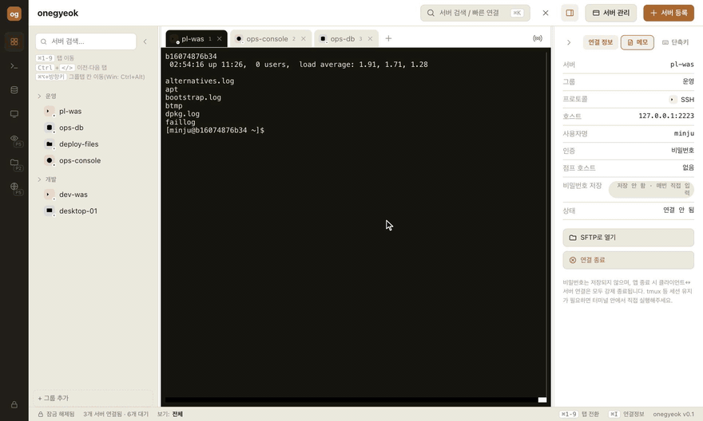
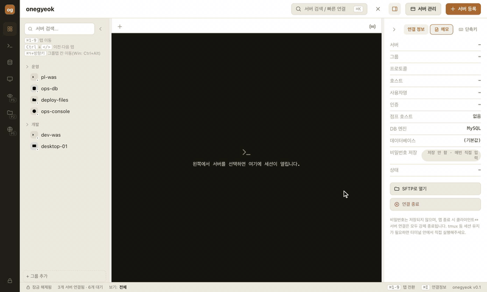
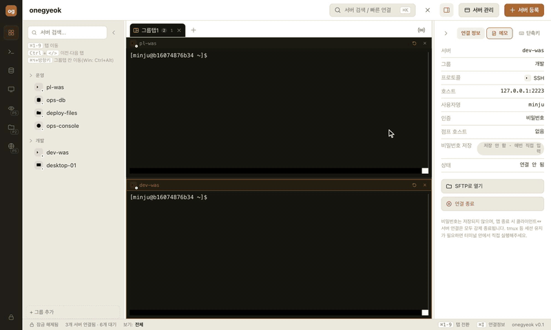
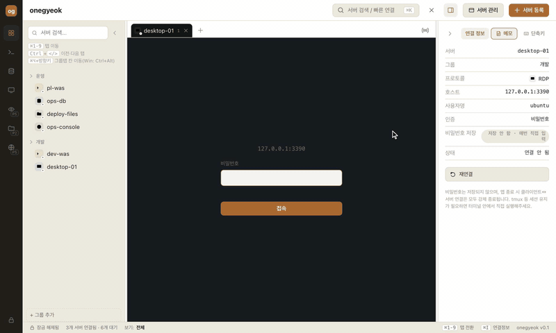
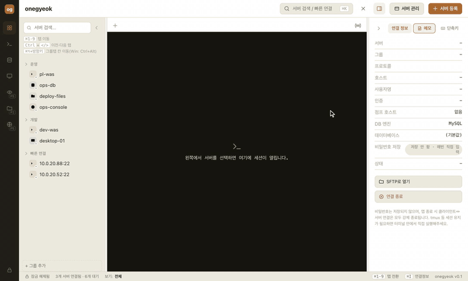
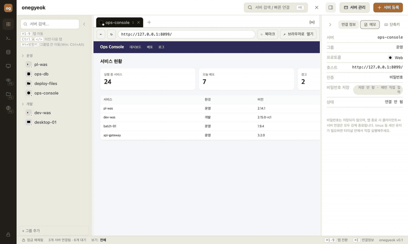

<h1 align="center">
   onegyeok
</h1>

  
  
  
  

  <a href="../../README.md">한국어</a> · <a href="README.zh-CN.md">中文</a> · <b>日本語</b> · <a href="README.en.md">English</a>

  <strong>SSH · SQL · SFTP · RDP · VNC · Web — 散らばったリモート接続クライアントを、ひとつに。</strong> 
  サーバーを一度登録すれば、プロトコルに合わせてすぐ接続。複数のセッションを1つの画面に並べて表示できます。 
  パスワードは一切保存せず、接続のたびに自分で入力します。

  
  &nbsp;
  

  <b>🍎 macOS — 初回起動時: システム設定 → プライバシーとセキュリティ → 下へスクロールして「このまま開く」をクリック → パスワード / Touch ID で認証</b> 
  <b>🪟 Windows — 「Windows によって PC が保護されました」（SmartScreen）が表示されたら: 詳細情報 → 実行</b>

  インストール方法と<b>初回起動時のセキュリティ許可</b>については、下の <a href="#install">Install</a> をご覧ください · <a href="https://github.com/minaridat/onegyeok/releases">すべてのリリース</a>

  

> **お知らせ:** アプリの画面表示は現在韓国語です。以下ではボタンやメニュー名を日本語で説明し、括弧内に韓国語の表示を併記します。

---

## Features

<table>
<tr>
<td width="42%" valign="middle">

### スプリットビュー（グループタブ）

タブを別のタブの画面の端にドラッグすると、**SSH · SQL · SFTP · RDP · VNC · Web のどの組み合わせでも**1画面に並べて表示できます。最大6ペイン、境界線をドラッグしてサイズ調整、ペインのヘッダーをタブバーにドラッグすれば独立したタブに戻ります。

[使い方 →](#split-view)

</td>
<td width="58%">
  
</td>
</tr>
<tr>
<td width="42%" valign="middle">

### SSH ターミナル

xterm.js ベースのターミナル。ログイン名は表示され、パスワードは `*` で表示されます。接続プロンプトは**ターミナルの中**にそのまま表示。鍵認証と踏み台サーバーにも対応しています。

[使い方 →](#connect)

</td>
<td width="58%">
  
</td>
</tr>
<tr>
<td width="42%" valign="middle">

### 複数サーバーへ同時入力

複数の SSH セッションにチェックを入れると、**パスワード入力の段階から**同じキー入力がすべてに同時送信されます。対象は赤い枠で表示されます。

[使い方 →](#broadcast)

</td>
<td width="58%">
  
</td>
</tr>
<tr>
<td width="42%" valign="middle">

### SQL クライアント

MySQL / MariaDB · PostgreSQL · MS SQL Server に接続してクエリを実行し、結果を表で確認できます。

[使い方 →](#connect)

</td>
<td width="58%">
  
</td>
</tr>
<tr>
<td width="42%" valign="middle">

### SFTP / FTP / FTPS ファイルエクスプローラー

ローカル・リモートの**デュアルペイン**、ファイル／フォルダの再帰転送、比較と同期、一括名前変更、予約転送、転送キュー（一時停止・再開・キャンセル）、SHA-256 検証。

[使い方 →](#connect)

</td>
<td width="58%">
  
</td>
</tr>
<tr>
<td width="42%" valign="middle">

### RDP · VNC リモートデスクトップ

外部サーバー不要。ネイティブヘルパーがリモート画面をそのまま描画します。ウィンドウサイズを変えると**リモートの解像度も追従**（RDP）し、全画面・等倍表示にも対応します。

[使い方 →](#connect)

</td>
<td width="58%">
  
</td>
</tr>
<tr>
<td width="42%" valign="middle">

### Web コンソール · ブックマーク

内蔵ブラウザで社内の Web コンソールを開きます。アドレスバーは Chrome のように直接編集でき、`☆` で現在のページをサーバーとして登録できます。Cookie はディスクに残りません。

[使い方 →](#connect)

</td>
<td width="58%">
  
</td>
</tr>
<tr>
<td width="42%" valign="middle">

### クイック接続

サーバーを登録しなくても、**ホスト・ユーザー名・パスワードを1つのフォームに**入力するだけで接続できます。プロトコルごとに直近5件の履歴を保持し（`×` で削除）、アドレスを間違えた場合はタブの上で修正して再接続できます。

[使い方 →](#quick-connect)

</td>
<td width="58%">
  
</td>
</tr>
<tr>
<td width="42%" valign="middle">

### ショートカットガイド内蔵

右パネルの**ショートカット**（단축키）タブに、macOS / Windows のショートカットがすべてまとまっています（現在の OS が上に表示されます）。

[ショートカット一覧 →](#shortcuts)

</td>
<td width="58%">
  
</td>
</tr>
</table>

**その他:**

- **ローカルターミナル** — サイドバーの **로컬 터미널** ボタン（または `Ctrl+Shift+T`）で、このPCのシェル（macOS：ログインシェル、Windows：`cmd.exe`）を SSH と同じ画面で開きます。`git` などのローカルコマンドをアプリ内で使え、スプリットビューや同時入力にも対応します。
- **セッションログ** — SSH とローカルターミナルの画面に出力された内容（入力したコマンドを含む）が、行ごとに時刻付きで自動的にファイルへ記録されます。右パネルの **세션 로그**（セッションログ）タブで閲覧・検索でき、保存期間（30日〜1年）や記録のオン／オフを設定できます。アプリ上では編集・削除できず、期間を過ぎると自動削除されます。パスワードは画面に表示されないため記録されません。
- **RDP クリップボードとフォルダーマウント** — 接続フォームで **클립보드 공유**（クリップボード共有、テキストの双方向コピー＆ペースト）をオンにし、**로컬 폴더 마운트…** でPCのフォルダーをリモートのドライブとして接続できます。macOS では `⌘C`/`⌘V` がリモートの `Ctrl+C`/`Ctrl+V` として送られます。
- **パスワードを保存しない** — パスワードと鍵のパスフレーズは1回の接続の間だけメモリ上で使われ、破棄されます（ISMS 審査を想定した設計）。
- **サーバー一覧を暗号化して保存** — ホスト・グループ・メモは OS のキーチェーンで暗号化され、再起動後も保持されます。
- **同じサーバーへ複数セッション** — サーバーをもう一度クリックすると、常に新しいタブ・新しい接続が開きます。
- **複数ウィンドウ** — タブをウィンドウの外にドラッグすると新しいウィンドウに分離できます。ウィンドウタイトルには `onegyeok 6` のように開いているセッション数が表示されます。
- **アプリ終了時にすべての接続を切断** — 見えないところで接続が残ることはありません。

---

## Install

### macOS — Apple Silicon（M1 以降）、macOS 15 以上

1. **[onegyeok-arm64.dmg をダウンロード](https://github.com/minaridat/onegyeok/releases/latest/download/onegyeok-arm64.dmg)** して開き、`onegyeok` を**アプリケーション**フォルダにドラッグします。
2. **初回起動時にはセキュリティの許可が必要です。** まだ Apple の公証を受けていないため、macOS が*「開発元を検証できません」*という警告でブロックします。一度許可すれば、以降は通常どおり開きます。

   > **システム設定 → プライバシーとセキュリティ** → 下へスクロールして **「このまま開く」** をクリック → パスワード／Touch ID で認証

   （先に「アプリケーション」で `onegyeok` を一度ダブルクリックして警告を表示させると、「このまま開く」が現れます。）

   ターミナルで行う場合: `xattr -dr com.apple.quarantine /Applications/onegyeok.app`
3. Intel（x64）Mac には対応していません。必要なランタイム（RDP/VNC ヘルパーを含む）はすべてインストーラーに含まれています。

### Windows — Windows 10 22H2 以上 / 11（x64）

1. **[onegyeok-x64.exe をダウンロード](https://github.com/minaridat/onegyeok/releases/latest/download/onegyeok-x64.exe)** して実行します（インストール先を選択可能、管理者権限は不要）。
2. **「Windows によって PC が保護されました」（SmartScreen）** が表示されたら、**詳細情報 → 実行** をクリックしてください。まだコード署名証明書がないインストーラーのため表示される警告です。

> アプリのデータ（サーバー一覧・メモ）は、macOS では `~/Library/Application Support/onegyeok/`、Windows では `%APPDATA%\onegyeok\` に暗号化されて保存され、アプリを削除しても残ります。完全に消すにはこのフォルダも削除してください。

ソースからの実行やインストーラーの自前ビルドは **[開発者ガイド](../DEVELOPER.md)**（韓国語）をご覧ください。

---

## 使い方マニュアル

### はじめに

1. 上部の **[+ サーバー登録]**（서버 등록）でサーバーを登録します（名前・グループ・プロトコル・ホスト・ポート・ユーザー名）。登録せずに、左のレールでプロトコルを選んで**[クイック接続](#quick-connect)**することもできます。
2. サーバー一覧でサーバーをクリックすると**新しいタブ**が開き、接続が始まります。
3. パスワードは接続のたびに入力します（保存されません）。

### 画面構成

| 領域 | 説明 |
|---|---|
| **左レール** | プロトコルフィルター（すべて · SSH · SQL · RDP · VNC · SFTP · Web）。開いているセッションがないとクイック接続フォームが表示されます |
| **上部バー** | サーバー検索 / クイック接続（⌘K）· タブを閉じる · 情報パネルの切替 · サーバー管理（서버 관리）· サーバー登録（서버 등록） |
| **サーバー一覧** | グループ別のサーバーツリー。`‹`（⌘B）で折りたたむと境界線ごと完全に消え、タブ行の左端の小さなボタンで再表示します |
| **タブ行** | 開いているセッションのタブ。右端の `((•))` が同時入力の切替で、その隣の小さなボタンで折りたたんだ情報パネルを再表示します |
| **情報パネル** | 4つのタブ：接続情報（연결 정보）· メモ（메모）· ショートカット（단축키）· セッションログ（세션 로그）。`›`（⌘I）で折りたたみ |

### 接続方法

| プロトコル | 接続方法 | 主な機能 |
|---|---|---|
| **SSH** | ターミナルに表示される `login as:` / `password:` に入力（パスワードは `*` 表示）。失敗時は最大3回再入力、`Ctrl+C` でキャンセル。切断されたらタブの ↻ で再接続 | 鍵認証、踏み台サーバー、**SFTP で開く**、同時入力 |
| **SQL** | 接続フォームに（ユーザー名と）パスワードを入力 | MySQL/MariaDB · PostgreSQL · MS SQL、`⌘/Ctrl+Enter` で実行（選択範囲のみ実行も可）、結果テーブル |
| **SFTP / FTP / FTPS** | ユーザー名とパスワードを入力 | デュアルペイン、ドラッグ／ボタンでアップロード・ダウンロード、比較と同期、一括名前変更、予約転送、キュー、SHA-256 検証。平文 FTP は接続前に警告 |
| **RDP / VNC** | 接続フォームに（ユーザー名と）パスワードを入力 | ツールバー：等倍 ↔ ウィンドウに合わせる · 全画面 · 切断。RDP はウィンドウ／ペインのサイズに合わせて解像度が自動変更、**クリップボード共有・ローカルフォルダーのマウント**（接続フォーム） |
| **Web** | URL をサーバーとして登録（またはクイック接続） | アドレスバーを直接編集（Enter で移動、Esc で元に戻す）、戻る・再読み込み、`↗` 既定のブラウザで開く、`☆` ブックマーク。自己署名証明書は既定でブロックされ、「このタブでのみ続行」で許可可能 |

### クイック接続

登録せずにすぐ接続します。レールでプロトコルを選ぶ（開いているセッションがない状態）とフォームが表示されます。

- **1つのフォームで完結** — ホスト・ポート・ユーザー名・パスワードを入力して接続すると、2つ目のログイン画面なしで接続されます（VNC はパスワードのみ、Web はアドレスのみ）。
- **直近5件** — プロトコルごとの履歴（ホスト・ポート・ユーザー名のみ。**パスワードは保存しません**）が残り、`×` で1件ずつ削除できます。
- **アドレスを間違えたら** — タブの上のバーでアドレス／ユーザー名／パスワードを直して「再接続」を押すと、間違えた履歴も一緒に整理されます。

### スプリットビュー

1. **結合** — タブを別のタブの画面の**端（25%）**にドラッグすると、その方向に分割されます（中央では何も起きず、上限を超える方向はグレーになります）。
2. **グループタブ** — 結合されたタブは `그룹탭1`（「グループタブ1」）という1つのタブとして表示されます。**ダブルクリック**で名前を変更できます（Enter で確定、Esc でキャンセル）。
3. **ペインヘッダー** — サーバー名と状態、**同時入力チェック（SSH）· 再接続 ↻ · 閉じる ×**。ペインをクリックするとフォーカスされ、情報パネルも切り替わります。
4. **サイズ調整** — ペイン間の境界線をドラッグします（最小 280×180px、最大6ペイン）。
5. **取り出し** — ペインのヘッダーをタブバーにドラッグすると独立したタブに戻ります。ウィンドウの外へドラッグすると新しいウィンドウで開きます。
6. 分割レイアウトは**保存されません**（再起動後は個別のタブになります）。

### 同時入力

タブ行右端の `((•))` をオンにすると、開いている各 SSH セッションにチェックボックスが現れ（スプリットビューではペインヘッダー）、警告バナーが表示されます。チェックしたセッションは**赤い枠**で表示され、パスワードプロンプトからの入力がチェックしたすべてのサーバーに同時に送信されます。パスワードが複数のサーバーに送られるため、慎重にご利用ください。

### ショートカット

| 操作 | macOS | Windows |
|---|---|---|
| サーバー検索 / クイック接続 | `⌘K` | `Ctrl+K`  *（ターミナル入力中は無効）* |
| サーバー一覧の折りたたみ／展開 | `⌘B` | `Ctrl+B` *（ターミナル入力中は無効）* |
| 情報パネルの折りたたみ／展開 | `⌘I` | `Ctrl+I`  *（ターミナル入力中は無効）* |
| ポップアップを閉じる（サーバー登録・編集、サーバー管理、`⌘K` 検索） | `Esc` | `Esc` |
| タブを閉じる（グループタブはグループ全体） | `⌘W` | `Ctrl+Shift+W` |
| ローカルターミナルを開く（このPCのシェル） | `Ctrl+Shift+T` | `Ctrl+Shift+T` |
| 番号でタブ移動 | `⌘1`–`⌘9` | `Ctrl+1`–`Ctrl+9`  *（ターミナル入力中は無効）* |
| 前へ / 次のタブ | `Ctrl+<` / `Ctrl+>` | `Ctrl+<` / `Ctrl+>` |
| 前へ / 次のタブ（代替） | `Ctrl+Tab` / `Ctrl+Shift+Tab`、`⌘<` / `⌘>` | `Ctrl+Tab` / `Ctrl+Shift+Tab` |
| グループタブ内のペイン移動 | `⌘⌥+矢印キー` | `Ctrl+Alt+矢印キー` |
| SQL クエリの実行 | `⌘Enter` | `Ctrl+Enter` |
| グループタブ名の変更 | タブをダブルクリック → `Enter` / `Esc` | 同じ |

マウス: タブを端へドラッグして**結合** · ペインヘッダーをタブバーへドラッグして**取り出し** · 境界線をドラッグして**サイズ調整** · ウィンドウの外へドラッグして**新規ウィンドウに分離**。

### よくある質問

<b>パスワードは本当にどこにも保存されませんか？</b>

保存しません。接続のたびに入力し、その1回の接続の間だけメモリ上で使って破棄します。保存されるのは、OS のキーチェーンで暗号化したサーバー一覧・メモ・クイック接続履歴（ホスト・ポート・ユーザー名）だけです。

<b>別の Mac/PC でもサーバー一覧は表示されますか？</b>

いいえ。暗号化キーはそのコンピューターのログインキーチェーン（Windows では DPAPI）にだけあり、iCloud キーチェーンでは同期されないため、コンピューターごとに登録が必要です。`servers.dat` ファイルだけをコピーしても開けません。

<b>アプリを終了しても SSH セッションは維持されますか？</b>

いいえ。アプリを終了すると開いているすべての接続が切断されます。サーバー側でセッションを維持したい場合は、ターミナル内で `tmux` などを自分で実行してください。

<b>サーバー一覧を完全に初期化するには？</b>

`~/Library/Application Support/onegyeok`（Windows は `%APPDATA%\onegyeok`）を削除し、macOS ではキーチェーンアクセスで `onegyeok Safe Storage` の項目も削除してください。

---

## ドキュメント

| | |
|---|---|
| **[開発者ガイド](../DEVELOPER.md)** | ソースからの実行 · インストーラーのビルド（macOS/Windows）· 技術スタック（韓国語） |
| [機能仕様](../기능명세/) | プロトコル別の機能仕様と完了基準（韓国語） |
| [QA 記録](../QA.md) | 検証済みの項目と残課題（韓国語） |
| [企画書](../기획서.md) | 背景とセキュリティ要件（韓国語） |

## セキュリティ概要

- パスワードと鍵のパスフレーズは、いかなる形でも保存しません。
- サーバー一覧とメモは、OS の資格情報ストア（macOS キーチェーン / Windows DPAPI）に基づく Electron `safeStorage` で暗号化します。
- Web コンソールの Cookie はタブごとのメモリ専用パーティションに置かれ、ディスクには残りません。アカウントの自動入力もありません。
- アプリ終了時には、SSH/SQL/RDP/VNC/SFTP のすべての接続を例外なく終了します。
